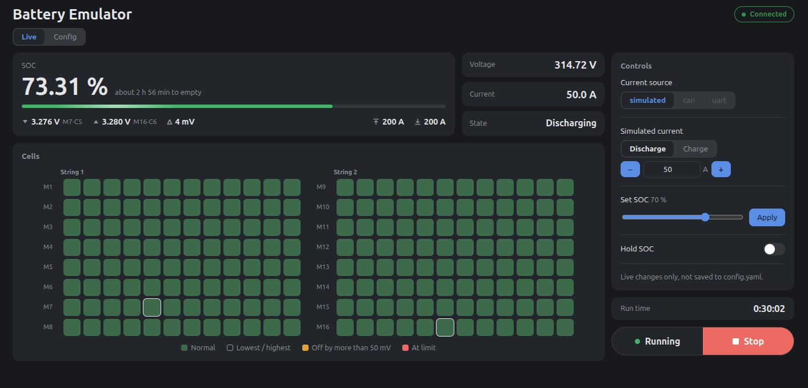

# Open Battery Emulator



## What is this

A battery pack in software, for a Raspberry Pi or a Linux laptop. Current goes in, and the
pack reacts like a real battery: SOC (state of charge) falls or rises, cell voltages move
and limits change. The data goes out on CAN and UART like a real BMS (battery management
system) would send it. Signals only, no real power.

## Why

Test a BMS master, an inverter, a charger, or CAN and UART tools without a real battery.
Jump to any SOC, hold the pack at one point, or reach full or empty in seconds.

## What you need

- A Raspberry Pi with Raspberry Pi OS Lite, or a Linux laptop with Python 3.11+ and
  [uv](https://docs.astral.sh/uv/).
- Optional: a CAN HAT or USB CAN adapter, or a USB serial adapter. Without them, use
  virtual CAN and a virtual UART.

## Quick install

On a Raspberry Pi:

```
curl -LsSf https://raw.githubusercontent.com/embashverse/open-battery-emulator/main/deploy/bootstrap.sh | bash
```

On a laptop (on a Pi from a clone, run `deploy/bootstrap.sh` instead of the last two
lines):

```
git clone https://github.com/embashverse/open-battery-emulator.git
cd open-battery-emulator
uv sync
uv run python -m emulator.engine
```

## Basic use

1. Open `http://localhost:8080`, or `http://<hostname>.local:8080` for a Pi.
2. Press **Play** (a Pi starts already running).
3. Change **Simulated current**, for example Discharge 50 A, and watch SOC and cell
   voltages move.

CAN and UART are off by default. Turn them on in the **Config** tab or in `config.yaml`.

## Documentation

- [Documentation](docs/index.md), starting with the introduction
- [Configuration](docs/configuration.md): every setting
- [Interfaces](docs/interfaces/index.md): CAN and UART
- [Testing without hardware](docs/interfaces/testing-without-hardware.md)
- [Troubleshooting](docs/troubleshooting.md)

## Status

Tested on a Raspberry Pi 4 and Linux laptops with virtual CAN and UART. Physical CAN
adapters should work through SocketCAN, but are not tested yet.

## License

License: to be decided.
