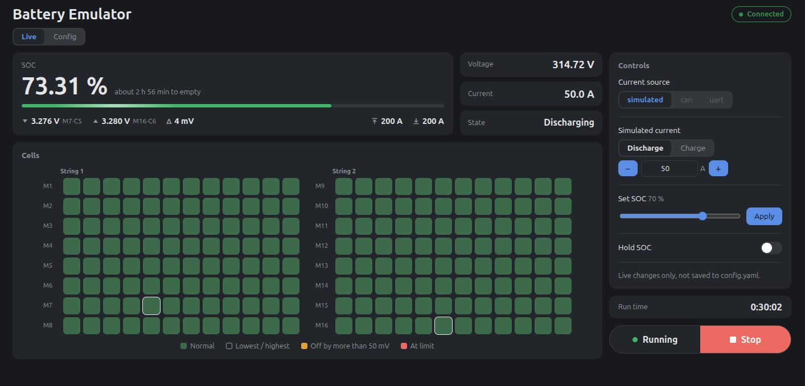

# Open Battery Emulator

A battery pack in software for a Raspberry Pi or a Linux laptop. This page says what it
is, what it is for and how it works.



## What it is

Current goes in, and the pack reacts like a real battery: SOC falls or rises, cell voltages
move and current limits change. The pack data goes out on CAN and UART, the way a real BMS
sends it. Only signals are emulated, no real power flows.

??? info "Words used in these pages"
    | Word | Meaning |
    |---|---|
    | SOC | state of charge: how full the battery is, 0 to 100 % |
    | BMS | battery management system: the electronics in a real battery that measure and protect the cells and report their values |
    | CAN | Controller Area Network: a two wire bus used in cars, inverters and batteries. Devices send short numbered messages called frames |
    | UART | a simple serial link, one wire to send, one to receive. Here it carries readable text lines |
    | cell, module, string, pack | cells in series make a module, modules in series make a string, strings in parallel make the pack |

## What it is for

Testing a device that talks to a battery, without a real battery:

| You are testing | The emulator gives it |
|---|---|
| a BMS master or battery controller | pack and cell values on CAN or UART |
| an inverter or a charger | SOC, voltage and current limits that react to its current |
| CAN tools, decoders, dashboards | real looking frames from a DBC file |
| UART tools, serial terminals | checksummed text lines |

Jump to any SOC, hold the pack at one point, or reach full or empty in seconds instead of
hours.

## How it works

```
                        +---------------------------+
  current in            |        Pack model         |        data out
  ----------------->    |                           |   ----------------->
  - simulated           |  cells -> modules ->      |   - CAN frames
    (config.yaml or     |  strings -> pack          |   - UART text lines
    the web UI)         |                           |   - web UI (Live tab)
  - CAN (0x180)         |  SOC, cell voltages,      |   - terminal status line
  - UART ($CUR line)    |  limits, state            |
                        +---------------------------+
                          runs every 100 ms (a tick)
```

Everything is set in one file, `config.yaml`, which is always the one source of truth. The
emulator runs without a screen. The web UI is optional: live values, current control,
Play / Stop, and editing `config.yaml`. Where the current comes from is explained in
[Interfaces](interfaces/index.md); the inside of the model in
[Design](engineering/design.md).

## What has been tested

| Setup | Status |
|---|---|
| Raspberry Pi 4 as a service: starts at boot, survives a reboot, restarts after a crash | tested |
| Linux laptops and the Pi with virtual CAN (`vcan0`) and a virtual UART (`socat`) | tested |
| Web UI in a laptop browser | tested |
| Web UI on a phone, Pi UART with a USB serial adapter | not recorded yet |
| Physical CAN adapters (should work through SocketCAN) | not tested yet |

Every check with its date is in [Verification](engineering/verification.md#manual-checks).

**Next:** [Install](install.md) · [Using it](using.md) · [Configuration](configuration.md) ·
[Testing without hardware](interfaces/testing-without-hardware.md) ·
[Troubleshooting](troubleshooting.md)
