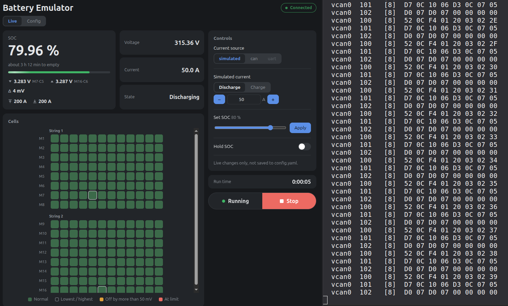

# CAN

What the emulator sends on CAN and how a device sends it the current. Settings are in
[Configuration](../configuration.md#interfacescan); to try it without hardware see
[Testing without hardware](testing-without-hardware.md#virtual-can).

CAN devices send **frames**: an **ID** (what is in it; lower IDs have higher priority) and
up to 8 data bytes. On Linux they are used through **SocketCAN**: a real adapter appears as
`can0`, a virtual one as `vcan0`. Turn CAN on with `interfaces.can.enabled: true`.

## Messages

All pack messages come from a **DBC file**, a standard text file that defines IDs, byte
layout, scaling and cycle time. Default: `interfaces/can/battery.dbc`.

| ID | Dir | Content | Cycle |
|---|---|---|---|
| 0x100 | out | pack voltage, current, SOC, state, counter | 100 ms |
| 0x101 | out | min and max cell voltage and which cell | 100 ms |
| 0x102 | out | max charge and discharge current | 100 ms |
| 0x180 | in | current command (0.1 A, discharge positive) | from the device |
| 0x200 ... | out | [module frames](#module-frames): every cell voltage, module status | 1000 ms |

## Signal names

| Signal name | Meaning |
|---|---|
| PackVoltage, PackCurrent, PackSOC | pack values |
| PackState, CurrentTimeout, TempOutOfRange, AliveCounter | status |
| CellVmax, CellVmaxModule, CellVmaxCell | highest cell and where |
| CellVmin, CellVminModule, CellVminCell | lowest cell and where |
| MaxChargeCurrent, MaxDischargeCurrent | limits |
| CurrentCommand | input from the device (read, not sent) |

To match your own system, edit the DBC or point `interfaces.can.dbc` to your own file.

??? info "Rules for your own DBC file"
    - Signals must use the emulator's names above, so the emulator knows what to put
      where. An unknown name stops the start with an error naming the signal.
    - Every message the emulator sends needs a `GenMsgCycleTime` that is a multiple of
      100 ms (one tick). A message holds either signals the emulator sends or signals it
      receives, never both.
    - Physical values are in V, A and %, like the pack result (so cell voltages use a
      factor of 0.001 V, which is 1 mV per bit).
    - `PackState` needs `VAL_` names for IDLE, CHARGING, DISCHARGING, FULL and EMPTY.
    - Each signal's range must hold the values this pack can reach (for example pack
      voltage up to cells in series x `v_max`), checked at start. `AliveCounter` counts 0
      to 255 and wraps.
    - CAN can provide current only if the DBC has a `CurrentCommand` signal.

## Sending current

Set `current.source: can`. The command is ID 0x180: signed 16 bit, 0.1 A per bit, little
endian (low byte first), discharge positive. It holds for `current.timeout_ms`, so repeat
it.

| Current | Raw value | Data bytes |
|---|---|---|
| 50 A discharge | 500 = 0x01F4 | `F4 01 00 00 00 00 00 00` |
| 20 A charge | -200 = 0xFF38 | `38 FF 00 00 00 00 00 00` |

Ready-to-run `cansend` loops are in
[Testing without hardware](testing-without-hardware.md#virtual-can).

## Module frames

Module frames depend on pack size, so they follow a pattern set in `config.yaml` instead
of the DBC. With the defaults:

```
0x200 + (module-1) x 0x10 + n     cell voltages, 4 cells per frame, uint16, 1 mV
0x200 + (module-1) x 0x10 + 0xF   module temperature and status
```

Example, default pack: module 1 uses 0x200 to 0x202 and 0x20F, module 2 starts at 0x210,
module 16 ends at 0x2FF.

??? info "Module frame details"
    Modules are numbered string by string: with 8 in series, module 9 is the first module
    of string 2. Frame n holds cells 4n+1 to 4n+4. Little endian.

    The status frame at offset 0xF:

    | Bytes | Content |
    |---|---|
    | 0-1 | module temperature, int16, 0.1 °C (the pack temperature for now) |
    | 2 | flags: bit 0 = temperature out of range, other bits 0 |
    | 3-7 | unused, 0xFF |

    Every module frame, including 0xF, always has DLC 8. Unused bytes are 0xFF, for
    example the end of a last cell frame with fewer cells. Checked at start: the cell
    frames of a module must fit below offset 0xF, `id_step` must be at least 0x10 so a
    module never overlaps the next one, the highest ID must be at most 0x7FF, and no
    module frame may use a DBC message ID.

## Watching the frames



```
candump vcan0
candump vcan0 | uv run python -m cantools decode interfaces/can/battery.dbc
```

The second line decodes each frame into named values.

??? info "When things go wrong"
    | Case | What happens |
    |---|---|
    | a value outside its signal range | clamped to the range, one warning per signal |
    | a received frame that cannot be decoded | skipped with a warning |
    | the bus refuses frames (no other device acknowledges on `can0`) | keeps running, one warning when sending fails, one when it works again |
    | the bus cannot be brought up (no HAT, wrong channel) | the emulator starts but stays Stopped and the web UI shows the error |

    The emulator never stops because of a value. Fixes are in
    [Troubleshooting](../troubleshooting.md).
