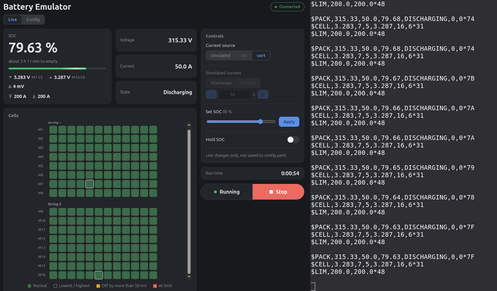

# UART

The text lines the emulator sends on a serial port, and the `$CUR` line a device sends to
set the current. Settings are in [Configuration](../configuration.md#interfacesuart); to
try it without hardware see [Testing without hardware](testing-without-hardware.md#virtual-uart).

A UART link has one wire to send (TX), one to receive (RX) and ground. The lines are
plain ASCII text, so any serial terminal shows them. Turn UART on with
`interfaces.uart.enabled: true`.

## Line format

Every line is `$TYPE,field,field*CS` and ends in `\r\n`. `CS` is the checksum: the XOR of
every character between `$` and `*` (not including them), written as two upper case hex
digits. Received checksums may be upper or lower case.

```
$PACK,312.45,50.0,80.00,DISCHARGING,0,0*7A
$CELL,3.287,5,7,3.301,12,2*3A
$LIM,200.0,200.0*48
$MOD,1,3295,3297,3301,3290,3296,3298,3293,3300,3294,3299,3292,3296*5C

$CUR,50*6D
$CUR,-20*47
```

The first four are sent by the emulator; each cycle ends with one empty line (receivers
should skip empty lines). The last two are commands from a device: 50 A discharge and
20 A charge.



??? info "Working out a checksum"
    XOR (bit by bit "one or the other, not both") the characters between `$` and `*`. In
    Python:

    ```python
    from functools import reduce

    body = "CUR,50"
    checksum = reduce(lambda a, b: a ^ b, (ord(c) for c in body))
    print(f"${body}*{checksum:02X}")  # $CUR,50*6D
    ```

## Sent every cycle_ms

| Line | Fields |
|---|---|
| `$PACK` | pack voltage (V, 2 decimals), pack current (A, 1 decimal, discharge positive), SOC (%, 2 decimals), state name (IDLE, CHARGING, DISCHARGING, FULL, EMPTY), current timeout (0/1), temperature out of range (0/1) |
| `$CELL` | lowest cell voltage (V, 3 decimals), its module, its cell, highest cell voltage (V, 3 decimals), its module, its cell |
| `$LIM` | max charge current (A, 1 decimal), max discharge current (A, 1 decimal) |
| `$MOD` | module number, then every cell voltage of that module in whole mV. One line per module, numbered string by string like the CAN module frames. Only if `modules` is true |

## Received

| Line | Fields |
|---|---|
| `$CUR` | current in A, discharge positive, a number like `50`, `-20` or `12.5`. Used when `current.source` is `uart`, with the timeout like every interface (REQ-10) |

Repeat it faster than `current.timeout_ms`. Ready-to-run loops are in
[Testing without hardware](testing-without-hardware.md#virtual-uart).

??? info "Rules for received lines"
    - A line with a wrong checksum, a wrong format (no `$`, no `*CS`, an unknown type, a
      `$CUR` without exactly one number) or longer than 128 characters (without `\r\n`)
      is ignored, with one warning per kind of problem. The emulator never stops because
      of input.
    - A line split across reads is put back together. If more than 128 characters arrive
      without an end, they are thrown away up to the next `\n`.
    - Empty lines are skipped without a warning.
    - The emulator's own line types (`$PACK`, `$CELL`, `$LIM`, `$MOD`) are ignored without
      a warning, so TX wired back to RX works.
    - 128 characters is a limit on received lines only. A `$MOD` line for a module with
      more than about 22 cells is longer.

??? info "When the port fails"
    Sending never stops the emulator. If a write or read fails (for example a USB adapter
    is unplugged), the port is closed, one warning is printed and the port is reopened
    every 2 seconds; once a line is written again, one more message says sending works
    again. A port that cannot be opened at Play is an error naming
    `interfaces.uart.port`.

## Line budget

At Play the emulator checks that one cycle's lines fit in 80 % of what `baudrate` carries
in `cycle_ms`. If not, Play stops with an error naming `interfaces.uart.baudrate`.

| Default 96s2p pack, `cycle_ms: 1000` | Bytes per cycle | Lowest baud rate that works |
|---|---|---|
| `modules: false` | 104 | 2400 |
| `modules: true` | 1247 (12470 bit/s, needs ≥ 15588 baud) | 19200 (9600 is refused) |

??? info "How the budget is worked out"
    Every line is built with the longest values the pack can give (pack voltage at
    `v_max` on every cell, the largest limit as a charge current, SOC 100.00,
    DISCHARGING, the highest module and cell numbers), plus one `$MOD` line per module if
    `modules` is true, each with its `\r\n`, plus the empty line that ends the cycle. On
    the wire one byte is 10 bits (start, 8 data, stop).

    pyserial's `loop://` port (what is written can be read back) is accepted as `port`;
    the tests use it. It holds only 4096 bytes, so use it for tests, not for long runs.
