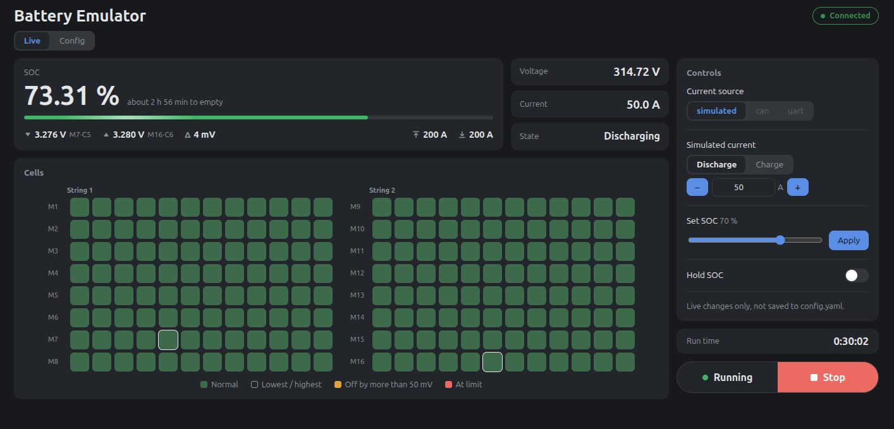
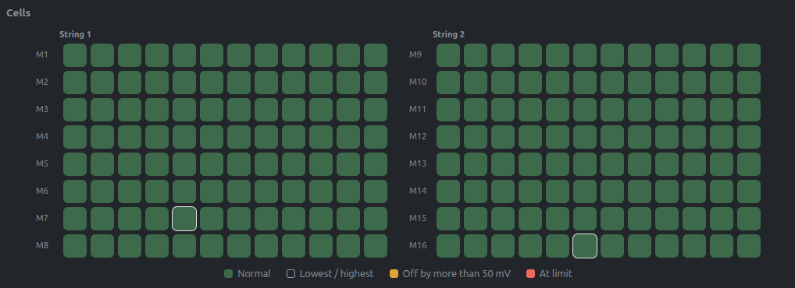
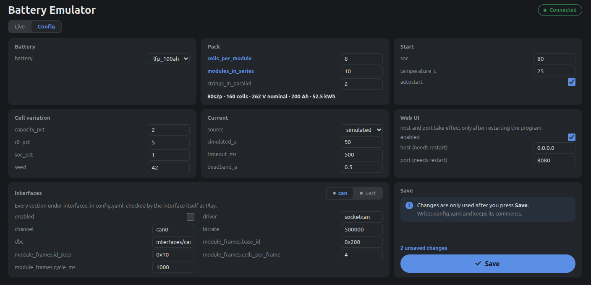

# Using it

How to run the emulator from the web UI or from the terminal alone. The web UI is optional;
the emulator runs the same without it.

!!! tip "Simulated or from a device"
    With `current.source: simulated` the emulator sets the current itself, from the web UI
    or `config.yaml`. No device is needed. With `can` or `uart` as the source, a device on
    the bus sends the current instead, and the timeout applies: no command within
    `current.timeout_ms` means 0 A and the Timeout flag. See
    [Interfaces](interfaces/index.md).

## The web UI

Open `http://localhost:8080` on the same computer, or `http://<hostname>.local:8080` from
another device on the same network. It needs no internet. It has two tabs, **Live** and
**Config**; the run state (Running or Stopped) shows on both.

!!! warning "No login"
    Anyone who can reach the port can see the values, change the current, stop the
    emulator and change `config.yaml`. Only run it on a trusted network, or set
    `webui.host: 127.0.0.1` so only this computer can open it.

### Live tab



Values update about twice a second. Hover or tap any symbol, flag or cell for an
explanation.

| You see | Meaning |
|---|---|
| SOC card | SOC, time to empty or full, a bar (green above 50 %, amber 20 to 50 %, red below 20 %), lowest and highest cell, spread, charge and discharge limit |
| Voltage, current, state | state is IDLE, CHARGING, DISCHARGING, FULL or EMPTY ([state machine](engineering/design.md#state-machine)) |
| Temperature flag | the temperature is outside the battery's operating range, limits are 0 |
| Timeout flag | the current comes from a device and no command arrived in time, so 0 A |
| Cell grid | every cell, strings side by side, one row per module |



| Cell colour | Meaning |
|---|---|
| light green | normal |
| amber | more than 50 mV from the pack average |
| red | at or beyond its minimum or maximum voltage, or the cell that caused FULL or EMPTY |
| thin outline | the lowest and the highest cell |

**Controls.** These are live changes: they are not saved to `config.yaml`, and Play starts
over from the file.

| Control | Example | Does |
|---|---|---|
| Current source | `simulated`, `can`, `uart` | where the current comes from. A source that cannot be chosen now is greyed, with the reason |
| Simulated current | Discharge `50` | the current when the source is `simulated`, sent after a short pause |
| Set SOC | `100` | jump every cell to this SOC, keeping the spread. `150` shows an error |
| Hold SOC | on | freeze SOC while current flows; voltages still show the I x R0 drop |

### Play and Stop

One run button: the left half shows the state (dot and Running or Stopped), the right half
the action (green **Play**, red **Stop**).

| Button | Does |
|---|---|
| Play | reads the saved `config.yaml`, checks it, builds a new pack, starts the interfaces. Time and live changes start over. On an error it stays Stopped and shows it |
| Stop | stops the interfaces (no more frames or lines). The last values and the page stay |

`start.autostart: true` (default) presses Play at program start.

### Config tab



Every setting in `config.yaml`, grouped as cards ([what each means](configuration.md)).

1. Press **Stop** (settings are editable only while stopped).
2. Change values; the Save card counts unsaved changes.
3. Press **Save**: checked with the same checks as Play, then written, comments kept.
4. Press **Play** to use them.

If the file is changed in an editor meanwhile, a reload notice appears and Save is refused
until you reload. `webui.host` and `webui.port` take effect after a program restart.

### Messages

Messages appear next to the button that caused them: under the run button (Live) or above
Save (Config). Errors are red and stay until closed, for example
`pack.cells_per_module must be at least 1`. Confirmations like "Saved" fade out. At most
three show at a time.

## Terminal status line

One line per second of emulated time (`--status-every N` for every N seconds; the Pi
service uses 10):

```
t=     1.0 s  DISCHARGING  I=   50.0 A  V=  315.36 V  SOC= 80.00 %  min 3.283 V (M7 C5)  max 3.287 V (M16 C6)
```

| Part | Meaning |
|---|---|
| `t` | emulated time since Play |
| `DISCHARGING` | the state |
| `I` | current that really flowed, A, discharge positive |
| `V` | pack voltage |
| `SOC` | average SOC |
| `min` / `max` | lowest and highest cell, module (`M`) and cell (`C`) |
| `TIMEOUT` | at the end when no command arrived within `current.timeout_ms`, so 0 A |

To run without the web page, set `webui.enabled: false`.
